<p align="center">
  <a href="README.md">简体中文</a> · <b>English</b>
</p>

<p align="center">
  <picture>
    <source media="(prefers-color-scheme: dark)" srcset="docs/assets/hero-en-dark.webp">
    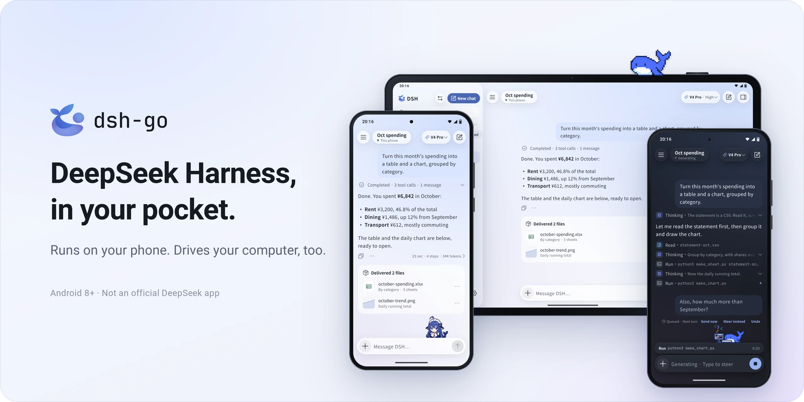
  </picture>
</p>

<p align="center">
  An Android client for DeepSeek Harness. Run DSH right on your phone, or drive the one on your computer.
</p>

> **This repository is a community fork, based on upstream `v1.0.13`.** It adds `gesture` for
> coordinate gestures, `input` for coordinate input, and `run` for bounded multi-step routines,
> plus text targeting, waiting, and scrolling until a target appears. Version 1.0.16 resolves
> targets on fresh observations, checks the foreground app, and returns progress on failure.
> See [Phone routines](examples/phone-routines/README.md) for a task skill, 30 scenarios, and a local test page.
> Upstream does not accept outside PRs, so this
> fork is maintained separately; see [Coordinate gestures](#gesture) and
> [docs/gesture-en.md](docs/gesture-en.md). Everything here, including the changes, is released
> under AGPL-3.0. Upstream is [ccch1mneyyy/dsh-go](https://github.com/ccch1mneyyy/dsh-go), by
> [ccch1mneyyy](https://github.com/ccch1mneyyy).
>
> **Install:** 1.0.16 is a local build delivery for arm64 and Android 8.0+ (screenshots require Android 11+).
> A community build with the same signing key can be upgraded in place, keeping data. A differently
> signed upstream APK cannot be replaced directly; never automatically uninstall it after an install failure.
> See the [routine contract](docs/phone-routines-en.md) and the delivery's actual validation report.

<p align="center">
  <a href="../../releases/latest"></a>
  <a href="LICENSE"></a>
  <a href="https://forum.dshtui.com"></a>
  <a href="https://qm.qq.com/q/OEy2RqZnqY"></a>
</p>

<p align="center">
  <a href="https://trendshift.io/repositories/319451"></a><br>
  <sub>#1 on Trendshift's all-language daily ranking · 2026-10-30</sub>
</p>

<br>

<h3 align="center">Deepy and Whale girl keep you company</h3>

<p align="center">They code, flip, wave and nap along with DSH, and can follow you to the home screen.</p>

<p align="center">
  <picture><source media="(prefers-color-scheme: dark)" srcset="docs/assets/pet-deepy-typing-en-dark.gif">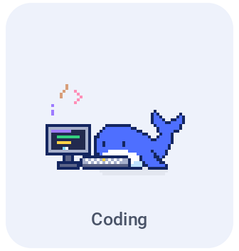</picture> <picture><source media="(prefers-color-scheme: dark)" srcset="docs/assets/pet-deepy-happy-en-dark.gif">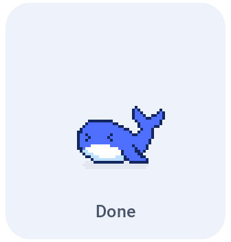</picture> <picture><source media="(prefers-color-scheme: dark)" srcset="docs/assets/pet-deepy-notification-en-dark.gif">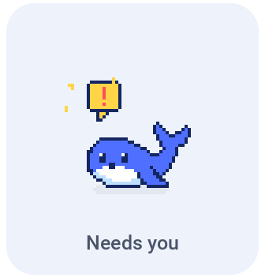</picture> <picture><source media="(prefers-color-scheme: dark)" srcset="docs/assets/pet-deepy-sleeping-en-dark.gif">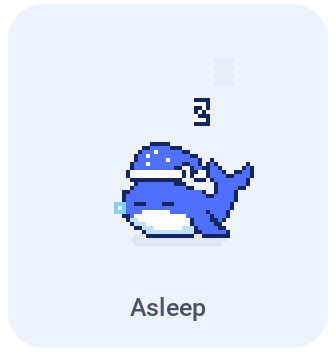</picture>
</p>

<p align="center">
  <picture><source media="(prefers-color-scheme: dark)" srcset="docs/assets/pet-girl-typing-en-dark.gif">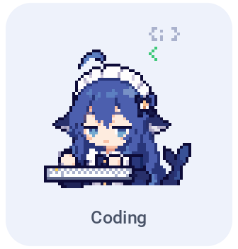</picture> <picture><source media="(prefers-color-scheme: dark)" srcset="docs/assets/pet-girl-happy-en-dark.gif"></picture> <picture><source media="(prefers-color-scheme: dark)" srcset="docs/assets/pet-girl-notification-en-dark.gif"></picture> <picture><source media="(prefers-color-scheme: dark)" srcset="docs/assets/pet-girl-sleeping-en-dark.gif">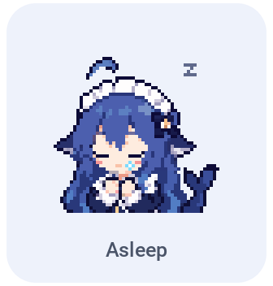</picture>
</p>

<br>

<a id="download"></a>
<h3 align="center">Download DSH Go</h3>

<p align="center">Get the latest APK from GitHub Releases or the download page at go.dshtui.com. Most phones need the arm64 package.</p>

<p align="center">
  <a href="../../releases/latest"></a>&emsp;<a href="https://go.dshtui.com/download"></a>
</p>

<p align="center">
  <b>Thank you all for supporting and loving DSH Go! iOS and HarmonyOS versions are coming as soon as I can make them. The more stars, the faster they come, hehe</b>
</p>

<p align="center">
  <a href="https://github.com/ccch1mneyyy/dsh-go/stargazers"></a>
</p>

<p align="center">
  <sub>New here? Start with the <a href="docs/guide/README.md">user guide</a>, and bring questions to the <a href="#community">forum and QQ group</a>.</sub><br>
  <sub>An early test build signed with a different key can't be updated in place: uninstall it first, which clears your chats, the Linux environment and settings.</sub>
</p>

<br>

<h3 align="center">Runs on your phone. Drives your computer.</h3>

<p align="center">A Linux environment built in, no root and no Termux. Switch to the DSH on your computer in one tap.</p>

<p align="center">
  <picture>
    <source media="(prefers-color-scheme: dark)" srcset="docs/assets/f-remote-en-dark.webp">
    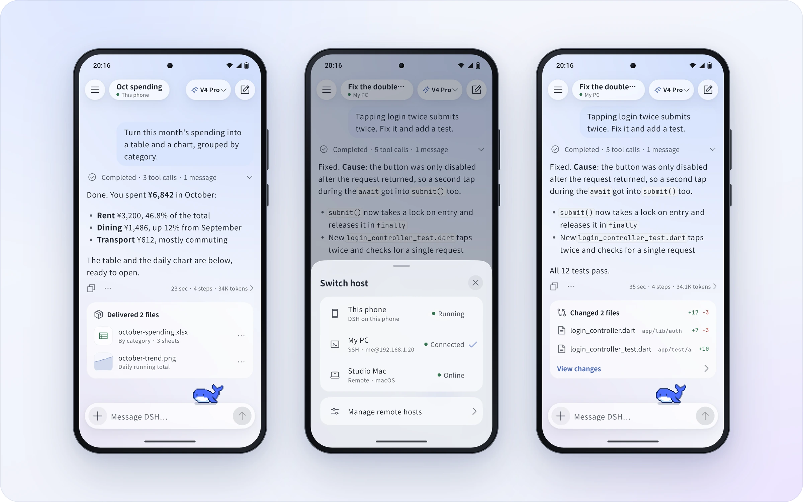
  </picture>
</p>

<br>

<h3 align="center">Chime in, interrupt, stay tidy</h3>

<p align="center">Send a message while DSH is replying, and tap "Send now" whenever you like. Finished steps fold into one line.</p>

<p align="center">
  <picture>
    <source media="(prefers-color-scheme: dark)" srcset="docs/assets/f-steer-en-dark.webp">
    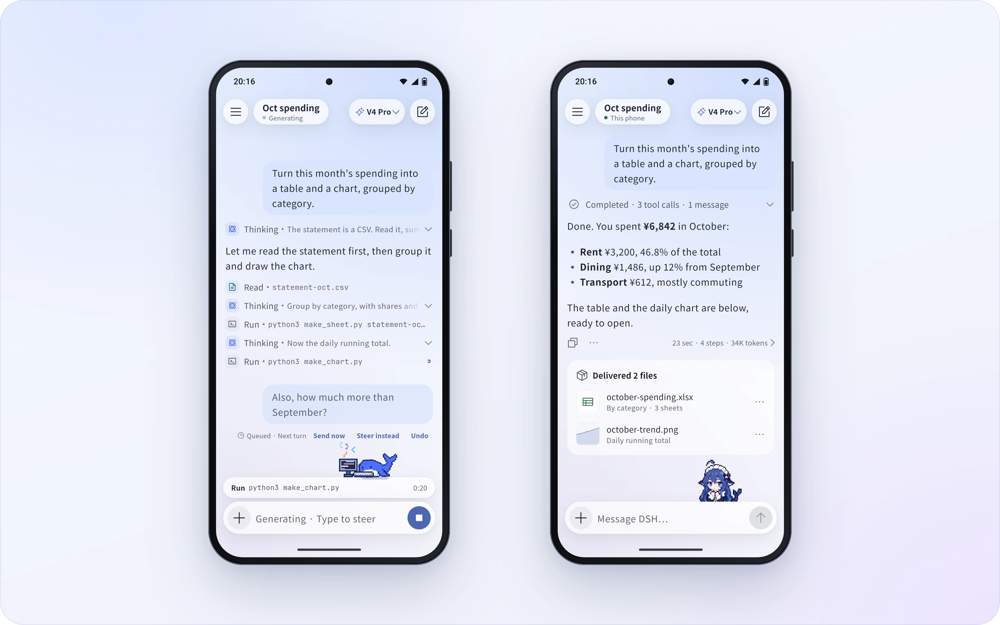
  </picture>
</p>

<br>

<h3 align="center">Native, with the web interface one tap away</h3>

<p align="center">Switch between the native app and the official web interface on the same chat. It reopens in whichever you used last.</p>

<p align="center">
  <picture>
    <source media="(prefers-color-scheme: dark)" srcset="docs/assets/f-web-en-dark.webp">
    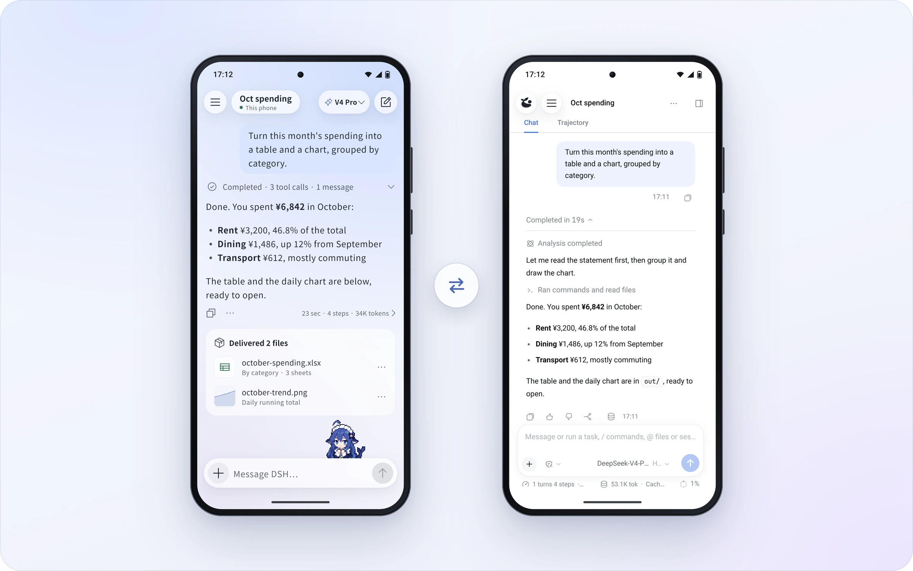
  </picture>
</p>

<br>

<h3 align="center">Share cards, replays and links</h3>

<p align="center">Turn a reply into a share card. Share a whole chat as a link that replays in any browser, end-to-end encrypted.</p>

<p align="center">
  <picture>
    <source media="(prefers-color-scheme: dark)" srcset="docs/assets/f-share-en-dark.webp">
    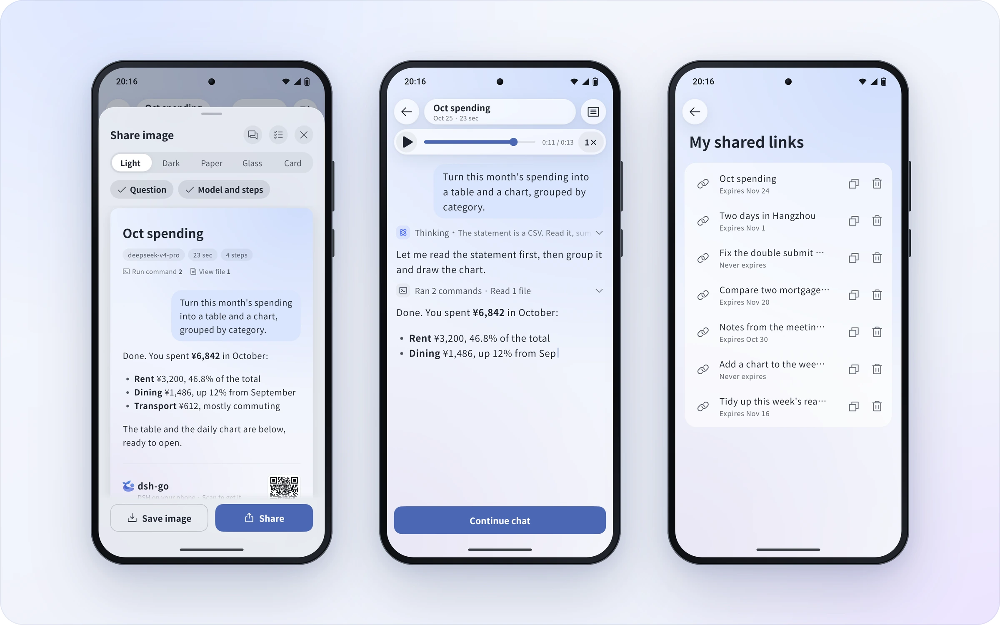
  </picture>
</p>

<br>

<h3 align="center">Landscape and tablets</h3>

<p align="center">New layouts for landscape phones and tablets: the sidebar stays, content stays centered, the keyboard never crowds.</p>

<p align="center">
  <picture>
    <source media="(prefers-color-scheme: dark)" srcset="docs/assets/f-adaptive-en-dark.webp">
    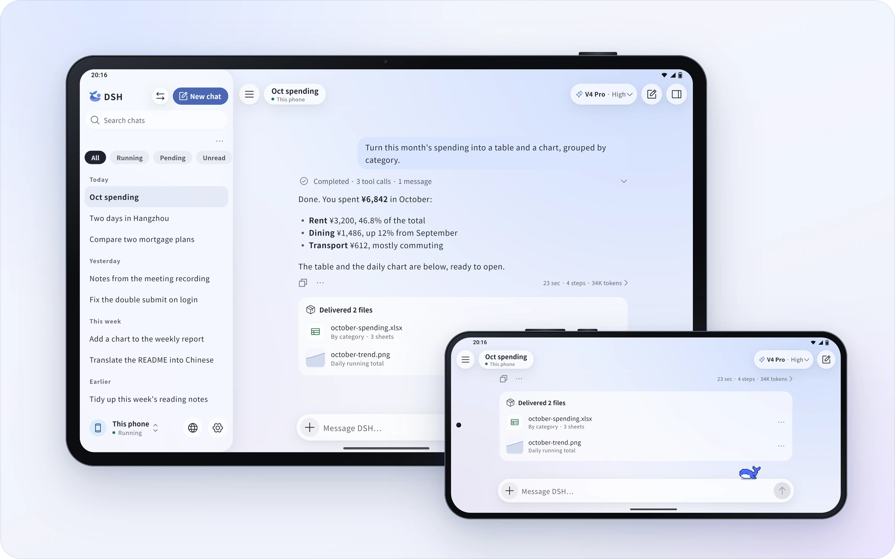
  </picture>
</p>

<br>

<h3 align="center">Colors and home screen icons</h3>

<p align="center">Six accent colors, your wallpaper's, or your own. Four home screen icons and three icon styles.</p>

<p align="center">
  <picture>
    <source media="(prefers-color-scheme: dark)" srcset="docs/assets/f-theme-en-dark.webp">
    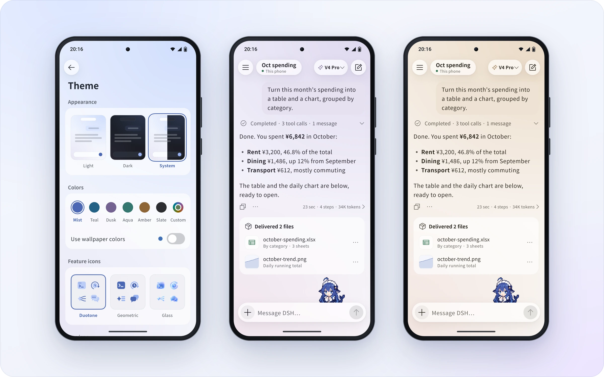
  </picture>
</p>

<br>

<h3 align="center">English and 中文</h3>

<p align="center">The whole app speaks both. It follows your system, or pick one in Settings.</p>

<p align="center">
  <picture>
    <source media="(prefers-color-scheme: dark)" srcset="docs/assets/f-lang-dark.webp">
    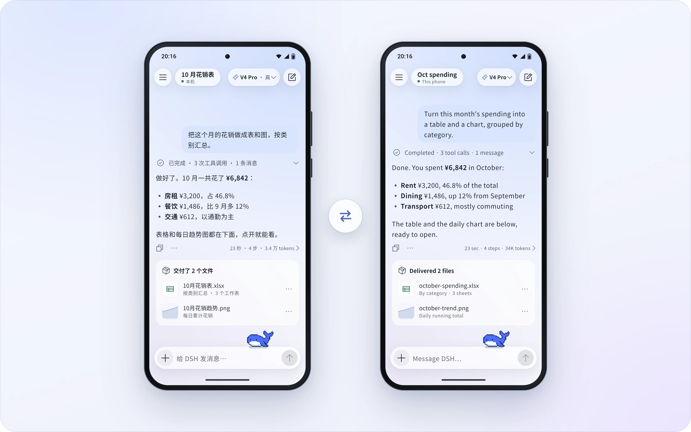
  </picture>
</p>

<br>

<h3 align="center">Phone control</h3>

<p align="center">DSH reads the screen and taps for you. Sensitive actions stay with you by default; understand the risks before relaxing app rules or lifting limits.</p>

<p align="center">
  <picture>
    <source media="(prefers-color-scheme: dark)" srcset="docs/assets/f-phone-en-dark.webp">
    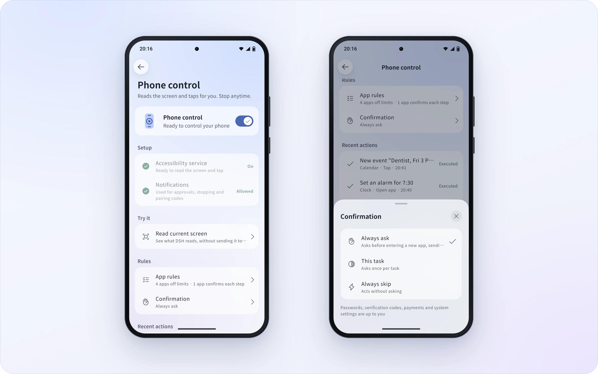
  </picture>
</p>

<br>

## Features

DSH Go combines a chat interface, an on-device runtime and remote connections. It is a third-party project built on [DeepSeek Harness](https://github.com/deepseek-ai/deepseek-harness). The DSH engine runs on your phone; model requests are still handled by the model provider you configure.

- **On-device runtime:** install Ubuntu, Node.js and DSH from the app without Root or a separate Termux installation.
- **Remote connections:** use DSH on a computer or server through SSH or [DSHarness Remote](https://github.com/liguobao/ds-harness-remote), developed by Li Guobao (liguobao).
- **Chat and tools:** switch models, send images, use voice input, and respond to tool approvals and questions. Chat and web interfaces are available.
- **Plugin interfaces:** use native tool cards, forms and panels from plugins adapted for DSH Go. This repository includes an SDK, guides and examples.
- **Phone control:** after you enable the required permissions, let the local engine read the screen, tap and type. You can stop it at any time.
- **Sharing and appearance:** share, export and replay conversations, and customize themes, icons and pets.

Capabilities depend on the host and connection. DSHarness Remote currently accepts image attachments only, does not open the web interface inside the app, limits plugin management to enabling or disabling plugins, and does not support DS Bot or conversation-log export. See [Engine and remote hosts](docs/guide/en/03-engine-hosts.md).

## Install

Installation requires Android 8.0 (API 26) or later. The **arm64** package on the Releases page is for typical 64-bit Android phones; the x64 package for x86_64 devices and emulators is under “Other builds” at the end of the release notes. This repository has no 32-bit ARM build.

1. Download the `arm64` APK from this repository's [Releases](../../releases/latest) (this fork only ships arm64), or get the official build from the upstream [download page](https://go.dshtui.com/download), and follow Android's prompt to allow that installation source.
2. On first launch, choose an on-device runtime or a remote host.
3. Configure a model and its credentials for the selected host, then start a conversation. Some remote providers must be configured on the host itself.

A remote-only setup does not need a local runtime on the phone. Phone control works with the local engine outside safe mode and requires permissions such as Accessibility, as explained in the app. Non-disruptive mode additionally requires Android 14 or later and Shizuku or self-ADB. Follow the [user guide](docs/guide/README.md) for setup.

The local engine uses compatible PRoot startup by default. Direct startup is off by default in Developer options; see [Troubleshooting](docs/guide/en/11-faq.md) for compatibility and fallback behavior. The current Android build targets APK sideloading, not Google Play distribution.

<a id="gesture"></a>
## Coordinate gestures (added by this fork)

Upstream can only tap a point (`tap_xy`); everything else is element-based, and a "long press" is
hard-wired in the source:

```kotlin
val duration = if (long) ViewConfiguration.getLongPressTimeout().toLong() + 300 else 60L
```

`gesture` replaces that with raw-coordinate gestures on the numbered screenshot (`screen` with
`image`). Every point is a pixel on that screenshot (its W×H), nothing is resolved from the tree,
and each call is confirmed by you, exactly like `tap_xy`. (The 15th tool, `input` — typing at a
coordinate — is [below](#input).)

| `kind` | What it does | Required | Optional |
| --- | --- | --- | --- |
| `tap` | Tap | `x` `y` | `duration` ms (default 60) |
| `long` | Press for any duration — 1500, 3000, 9000 ms | `x` `y` | `duration` ms (default 800) |
| `double` | Double tap | `x` `y` | `gap` 40–300 ms (default 120), `duration` ≤300 |
| `swipe` | Straight swipe between two points | `x` `y` `x2` `y2` | `duration` ms (default 300) |
| `path` | Swipe along any path | `points` (2–32 points) | `duration` ms (default 300) |
| `pinch` | Two-finger pinch | `x` `y` `spread` | `duration` ms (default 300) |

`steps` runs in order: up to 10 steps and 10 strokes within one call, 60 seconds in total. `gap`
(top level) is the pause between steps (default 120 ms). A `pinch`'s `spread` is the sum of both
fingers' travel — each finger moves `spread÷2`, positive zooms in, negative zooms out.

Hold for three seconds, swipe up, then double tap:

```json
{
  "observation": "s7",
  "steps": [
    {"kind": "long",   "x": 540, "y": 1200, "duration": 3000},
    {"kind": "swipe",  "x": 540, "y": 1500, "x2": 540, "y": 700, "duration": 500},
    {"kind": "double", "x": 540, "y": 1200}
  ]
}
```

Swipe along an arc, or zoom a photo:

```json
{"kind": "path",  "points": [[200, 1800], [500, 1500], [800, 1200]], "duration": 600}
{"kind": "pinch", "x": 540, "y": 900, "spread": 400}
```

Nothing in the safety boundary was relaxed: gestures are always confirmed, DSH's own UI, system
permission pages and unreadable screens are still refused, and the background screen (Shizuku /
self-ADB) still works by element number only. Details, limits and known trade-offs are in
[docs/gesture-en.md](docs/gesture-en.md) (Chinese: [docs/gesture-zh.md](docs/gesture-zh.md)).

<a id="input"></a>
## Coordinate input and tapping by text (added by this fork)

Upstream has exactly one way to write text: `type`, which takes an element id. Filling one field took three calls —
`screen` to find the id, `tap` to focus the field, `type` to write it — and the field the tap opened had a new id by the
next screen. This fork adds a 15th tool, `input`, which packs tap, focus, write, read-back and keyboard folding into one
call; `tap` also gains `text`, and `screen` / `scroll` gain `until`.

### `input`: type at a coordinate

| Parameter | Required | Meaning |
| --- | --- | --- |
| `observation` | yes | Screen id of the latest `screen`, which must have carried `image`; coordinates are that screenshot's pixels |
| `x` `y` | yes | Pixel coordinates of the field on the numbered screenshot |
| `text` | yes | Text to write, at most 2000 characters |
| `submit` | no | Send one IME enter after writing |

It tries four things in a row on the device and returns only when one of them lands:

1. tap the point and wait for the UI to settle;
2. find the current focus (`findFocus(FOCUS_INPUT)`) in any window; if it is editable, write with `ACTION_SET_TEXT` and
   read back every 100 ms for 1.5 s to prove the text arrived (whitespace, hyphens and zero-width characters ignored);
3. if focus did not land there, hold the point for 600 ms and look again — many WebView pages only focus on a real press;
4. otherwise use the clipboard: `ACTION_PASTE`, and if the node does not accept a paste, press again and click
   「粘贴」/「Paste」 by text in the menu that appears.

The back key is sent only when the keyboard really is up (it would cover the next screenshot's coordinates). Password
fields are refused: the confirmation card shows the app, coordinates and character count but never the text, because the
focused field could be a password box. The action log stores the length only.

```json
{"observation": "s7", "x": 540, "y": 760, "text": "13800138000"}
```

The coordinate guards are the same as `tap_xy`: stale screen id, a point outside the screenshot, DSH's own UI, system
permission pages, unreadable screens and "cannot confirm the screen still matches" are all refused, and the background
screen still addresses elements only.

### The other three parameters

- `tap` gains `text`: tap by the words on screen instead of looking up an id first (`id` and `text` are mutually
  exclusive). Matching runs five tiers — element text equal, row text equal, element text contains, row text contains,
  `viewId` contains — keeps actionable candidates only, and **refuses an ambiguous match** with the candidate list
  (`#7「删除」、#8「删除」`) instead of guessing.
- `screen` gains `until`: wait up to 5 s for that text before returning; `detail:true` now prints element bounds
  (`left,top-right,bottom`) instead of a centre point.
- `scroll` gains `until` / `max`: scroll in that direction until the text appears (10 times by default).

Self-test order on a phone: `screen` with `image` → `input` into a normal field → `input` with `submit` → `tap` with
`text` → `scroll` with `until`. Details and limits are in [docs/input-en.md](docs/input-en.md)
(Chinese: [docs/input-zh.md](docs/input-zh.md)).

### Build and signing differences in this fork

- Built with `tooling/build-apk.sh --build-name 1.0.15 -f arm64` on Windows, through
  `toolchain/env-win.sh` (JDK 17, Flutter 3.47.7, Android SDK 36, NDK 28.2.13676358).
- `runtime/out/arm64-v8a/{assets,jniLibs}` comes from the official upstream `v1.0.13` arm64
  package, so the runtime is identical to upstream `v1.0.13`. It is gitignored, as upstream does —
  only the app code differs.
- There is no `app/android/key.properties`, so the APK is **debug-signed**. Android will refuse to
  install it over the official release; uninstall that first, which clears app data (credentials
  and the downloaded runtime). Verify the download against the SHA-256 in the release notes.

## Data and permissions

Model requests go to the provider you configure. During phone-control tasks, relevant screen text may be sent to the model, and vision-capable models may receive screenshots. Read the app's permission disclosure before enabling the feature.

“Send anonymous usage statistics” is on by default. You can turn it off during onboarding or in Settings → Privacy and sharing. See [Troubleshooting](docs/guide/en/11-faq.md) for the fields collected and what happens when it is disabled. Review content before sharing it; recipients can save a copy of a shared link or file's contents.

## Risks and disclaimer

DSH Go is an unofficial community project. It is not affiliated with, endorsed by, or a representative of DeepSeek. Before using it, please understand:

- **AI is fallible:** answers, code and actions may be wrong, and malicious instructions in web pages, messages or files may mislead it. Verify important results; do not rely solely on AI output for high-stakes medical, legal or investment decisions.
- **Tools have real effects:** commands and file changes on local or remote hosts, as well as phone control, may cause data loss, privacy breaches, or harm to accounts, funds or devices. Skipping confirmations, relaxing app rules or lifting limits reduces safeguards; confirmation and blocking mechanisms cannot eliminate all risks. Keep default protections, grant only necessary permissions, and avoid lifting limits on devices holding payment or banking details. See the [phone-control guide](docs/guide/en/04-phone-control.md).
- **Third-party services and costs:** models, remote hosts and plugins operate under their own terms. Data handling, availability and charges depend on the services and configuration you choose. Running locally does not mean the model is offline or that data never leaves the device.
- **Take precautions:** back up important data, connect only to trusted hosts, install only trusted plugins, and monitor model usage and costs. Do not leave AI unattended on irreversible or high-risk tasks.
- **No warranty and limits of liability:** to the extent permitted by applicable law, the software is provided “as is,” without guarantees of accuracy, continuous availability or fitness for a particular purpose. See sections 15–17 of [LICENSE](LICENSE) for warranty disclaimers and liability limits. This notice does not exclude or limit liability that cannot legally be excluded or limited, or reduce your statutory rights.

## FAQ

<details>
<summary><b>Is this an official DeepSeek app?</b></summary>
<br>

No. DSH Go is an unofficial client made by the community, built on the open-source [DeepSeek Harness](https://github.com/deepseek-ai/deepseek-harness). DSH itself runs on your phone; model requests go to the provider you configure, so it needs a connection and bills your account with that provider.

</details>

<details>
<summary><b>Is it safe?</b></summary>
<br>

The local web interface only answers to the app itself. Shared links are end-to-end encrypted: the key lives only in the link, and the server never sees the content, but anyone with the complete link can read and save it. Phone control retains sensitive-action protections by default; relaxing app rules or using “Lift limits” reduces those protections. Safeguards cannot guarantee zero risk. See [Risks and disclaimer](#risks-and-disclaimer) and the [phone-control guide](docs/guide/en/04-phone-control.md).

</details>

<details>
<summary><b>Will the system kill it in the background?</b></summary>
<br>

Some battery savers hold apps back. When that happens, DSH Go tells you and opens the right setting, on vivo, Xiaomi, Huawei, Honor and OPPO.

</details>

<details>
<summary><b>What phone do I need?</b></summary>
<br>

Android 8 or later. On a phone, download the package on the Releases page; the x86_64 build for emulators is under “Other builds” at the end of the release notes. Running DSH on the phone needs the built-in environment, so keep about 1 GB free; connecting to DSH on a computer or server doesn't.

</details>

<details>
<summary><b>Is it open source?</b></summary>
<br>

Yes. The code is in this repository under [AGPL-3.0](LICENSE); `sdk/` and `examples/` are MIT. The DSH Go name and logo, and the mascots Deepy and Whale girl, are not covered by the open-source license; see [ASSETS.md](ASSETS.md). Credit requirements for forks and redistributed builds are in [License scope and redistribution](#license-scope-and-redistribution).

</details>

## Build from source

The following workflow targets **Linux x86_64**. The toolchain script currently defaults to JDK 17, Flutter 3.47.7 and the Android SDK/NDK. The app requires Dart `^3.13.5`. Prepare Bash, Git, curl, tar, unzip, xz, Python 3, zstd (for unpacking zstd-compressed deb archives when Python does not provide `compression.zstd`), file and standard GNU utilities. Resolving Ubuntu package locks again also requires gpgv.

Start with the complete source tree and project assets. Fonts, images and other files declared in `app/pubspec.yaml` are build inputs. The following script generates the runtime bundle.

```bash
git clone <this repository> dsh-go
cd dsh-go

bash tooling/setup-toolchain.sh
source tooling/env.sh
flutter --version
java -version

bash runtime/build-runtime.sh arm64-v8a
DSH_BETA_TOKEN_FILE= bash tooling/build-apk.sh -f arm64 --keep-daemon
```

The toolchain script downloads the SDK/NDK and emulator images and runs Android SDK license acceptance. Its default location is `~/dev`; set `DEV_ROOT` to use a separate directory. The script reuses existing installations, so check their versions before building.

The output is `app/build/app/outputs/flutter-apk/app-arm64-release.apk`. Runtime assembly uses the versions and verification data pinned in the repository and needs network access to download dependencies. `DSH_BETA_TOKEN_FILE=` leaves out the maintainer's beta-channel token. `--keep-daemon` preserves Gradle daemons, which is useful when working on other Android projects at the same time.

For an x86_64 APK, generate its runtime first:

```bash
bash runtime/build-runtime.sh x86_64
DSH_BETA_TOKEN_FILE= bash tooling/build-apk.sh -f x64 --keep-daemon
```

Without `app/android/key.properties`, a local release build uses debug signing. It cannot replace an official installation signed with a different key. Use a test device and preserve existing data; do not uninstall your daily-use app just to resolve a signing mismatch. Do not commit signing keys or their configuration.

To inspect APK build commands without building:

```bash
DSH_BETA_TOKEN_FILE= bash tooling/build-apk.sh --dry-run -f all
```

## Repository layout

| Path | Contents |
| --- | --- |
| `app/` | Flutter interface and Android Kotlin platform code |
| `packages/dsh_client/` | Dart client for the DSH Web API |
| `packages/dsh_remote/` | Dart client for DSH Remote |
| `runtime/` | Linux runtime assembly, engine patches and the app bridge |
| `sdk/plugin-kit/` | Native plugin authoring kit, used from the repository and not published to npm |
| `examples/plugins/` | Example plugins |
| `docs/guide/`, `docs/plugins/` | User and plugin development guides |
| `docs/assets/` | Showcase images, pet animations and community QR codes used on this page |
| `tooling/` | Toolchain, APK build and diagnostic scripts |
| `services/`, `site/`, `infra/` | Companion sharing service, website and deployment materials |

## Contribute

Report bugs and suggest improvements in [Issues](../../issues); problems in upstream itself can go to the [upstream issue tracker](https://github.com/ccch1mneyyy/dsh-go/issues). For code, documentation and translation changes, start with [CONTRIBUTING.en.md](CONTRIBUTING.en.md). Plugin authors can use the [plugin guides](docs/plugins/en/README.md) and [SDK](sdk/plugin-kit/README.en.md).

Report security issues through [SECURITY.en.md](SECURITY.en.md). Keep vulnerability details and credentials out of public issues.

<a id="community"></a>

## Community

- **Forum**: [forum.dshtui.com](https://forum.dshtui.com)
- **QQ group**: `1132118290` ([join](https://qm.qq.com/q/OEy2RqZnqY))
- **WeChat group**: scan the code below; if it has expired, join the QQ group
<!-- Telegram: link to come, add a line here -->

<p align="center">
  <a href="https://qm.qq.com/q/OEy2RqZnqY"><picture><source media="(prefers-color-scheme: dark)" srcset="docs/assets/qr-qq-en-dark.webp">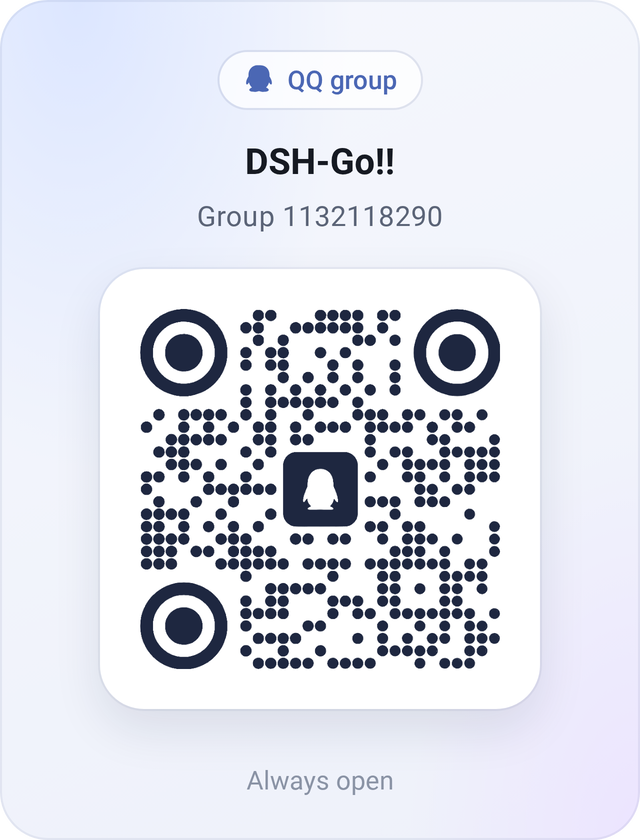</picture></a>&emsp;&emsp;<picture><source media="(prefers-color-scheme: dark)" srcset="docs/assets/qr-wechat-en-dark.webp">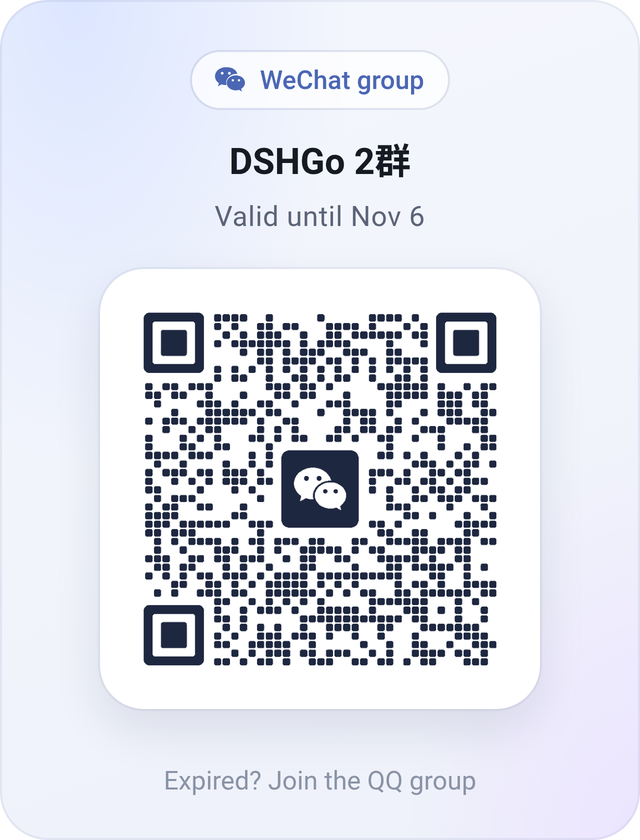</picture>
</p>

<p align="center">
  <sub>QQ group <code>1132118290</code>. On a computer, <a href="https://qm.qq.com/q/OEy2RqZnqY">join with one click</a>. The WeChat code changes every week; if it has expired, join the QQ group.</sub>
</p>

## Friends' Links

- **[DSH-TUI](https://dshtui.com/)**: the interactive terminal UI for DeepSeek Harness by the same author — the desktop counterpart to DSH Go, with a pixel whale, live status and time travel ([GitHub](https://github.com/ccch1mneyyy/dsh-TUI)).

## License scope and redistribution

The code is open source under [AGPL-3.0](LICENSE), and forking it to study, self-host or build on is welcome. Please respect the original author and project origin:

- **Please contact the author before making modifications.** If you plan to modify this project, develop it further or publish a derivative product, please contact the original author, ccch1mneyyy, through [Issues](https://github.com/ccch1mneyyy/dsh-go/issues) or the [community](#community) in advance and describe your intended use and plans.
- **Please credit the upstream repository and author in forks.** When publishing a modified version, please clearly credit <https://github.com/ccch1mneyyy/dsh-go> and the original author, [ccch1mneyyy](https://github.com/ccch1mneyyy), in the repository README, in-app About screen and release page. Retain copyright, license and modification notices as required by the applicable license.
- **No unauthorized commercial reskins.** Do not use this project's brand graphics or protected assets, including Deepy and Whale girl, in reskinned products for sale, paid distribution or other commercial products without permission. Do not violate the applicable license by removing required copyright and license notices or distributing derivative code without the required source, or impersonate the original author or an official release.
- **The name and assets are separate.** The DSH Go name and logo, and the Deepy and Whale girl mascots, are not covered by AGPL-3.0. Ship a modified build under your own name and assets; see [ASSETS.md](ASSETS.md).

**License clarification:** AGPL-3.0 permits modification, redistribution and commercial use subject to its terms. Advance contact and the requested credit locations above are collaboration requests from the author, not additional restrictions on the code license. Brand and asset use remains subject to their own terms; this notice does not change the licenses of `sdk/`, `examples/` or third-party content.

## License and acknowledgments

This project is licensed under [AGPL-3.0](LICENSE). `sdk/` and `examples/` remain **MIT**. Third-party code and assets retain the terms stated in their own notices.

- [DeepSeek Harness](https://github.com/deepseek-ai/deepseek-harness): the agent DSH Go runs and connects to.
- [DSH-TUI](https://github.com/ccch1mneyyy/dsh-TUI): home of the mascots, Deepy and Whale girl.

Code derived from Phase is used with the author's permission. DeepSeek Harness, PiPilot, DS Bot, DSH Remote and other third-party components and assets retain their own licenses and attribution. See [THIRD_PARTY_NOTICES.md](THIRD_PARTY_NOTICES.md) for sources and terms.

The DSH Go name, logo and mascots (Deepy and Whale girl) are not covered by the AGPL; see [ASSETS.md](ASSETS.md) for their terms.

<sub>Remote connections draw on the [ds-harness-remote](https://github.com/liguobao/ds-harness-remote) project and its server. Thanks to its author, liguobao.</sub>

<br>

<p align="center"><sub>DSH Go is an unofficial client made by the community. It is not affiliated with or endorsed by DeepSeek. DeepSeek names and marks belong to their owners.</sub></p>
