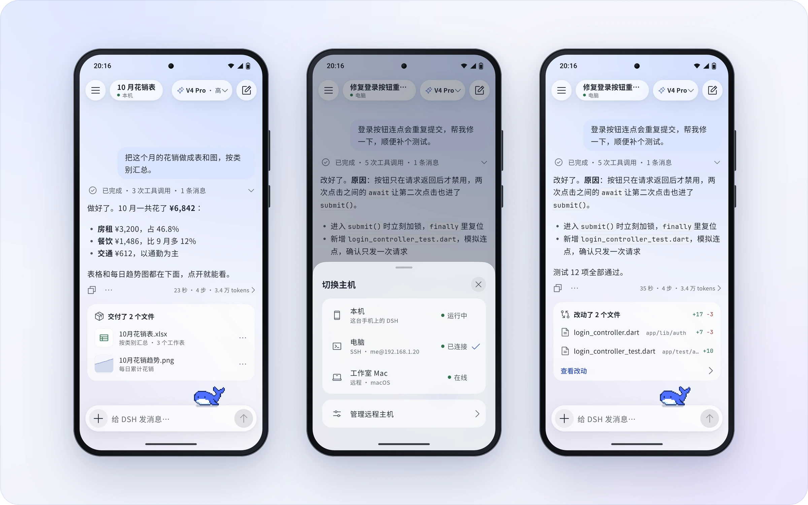
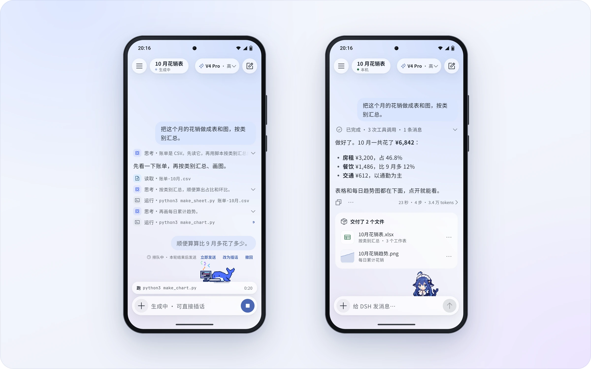
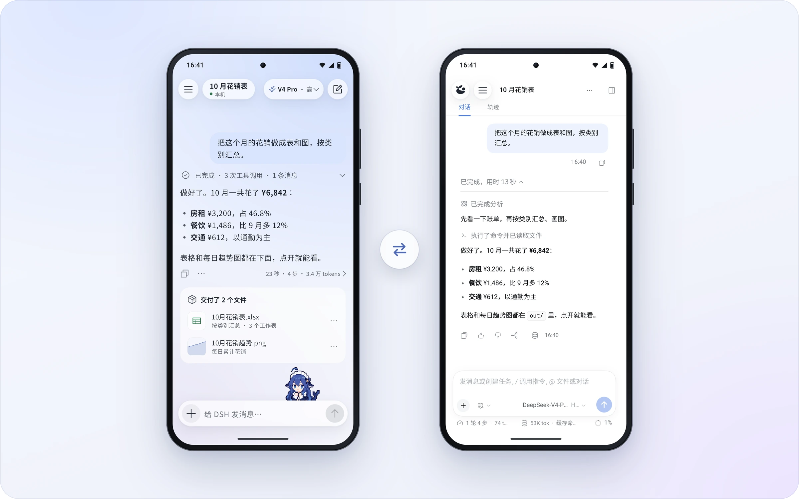
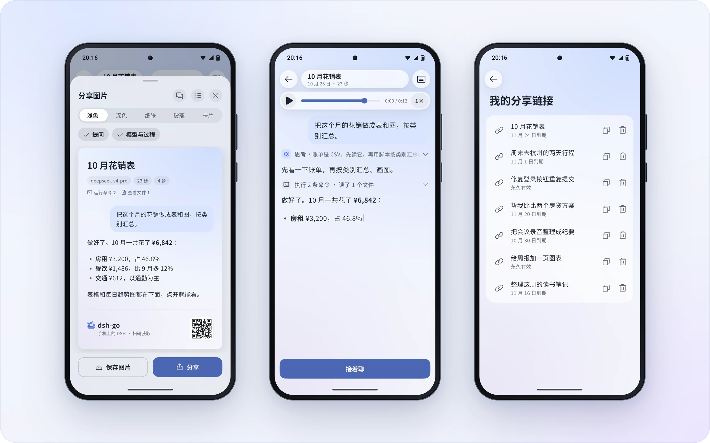
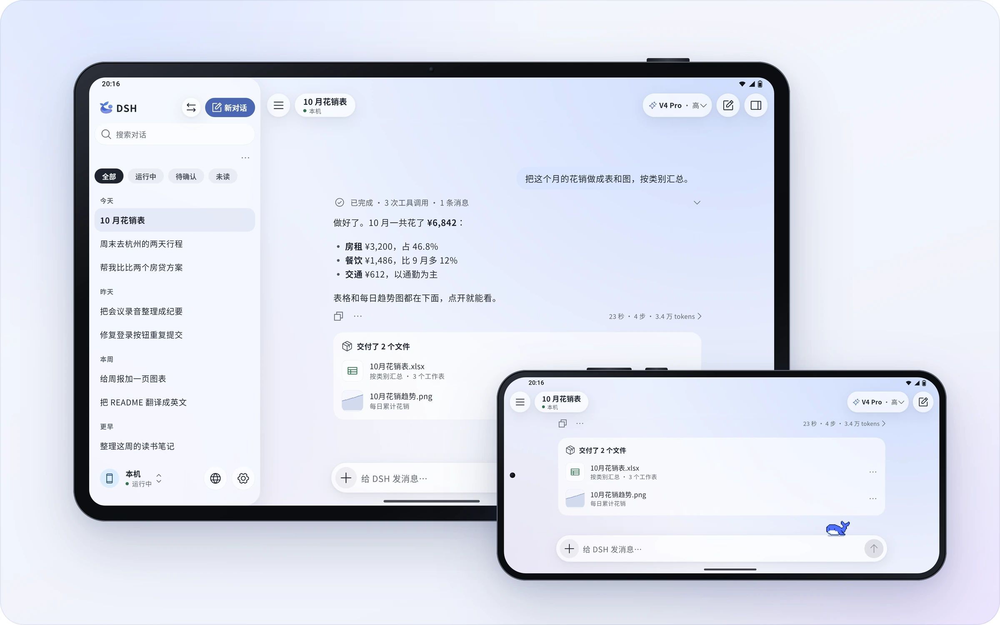
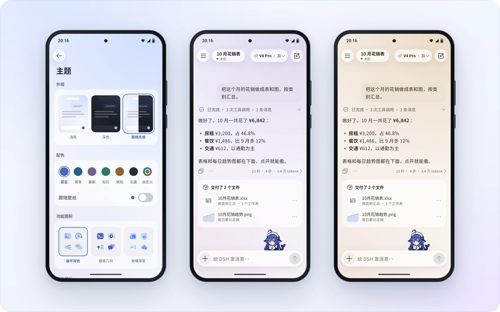
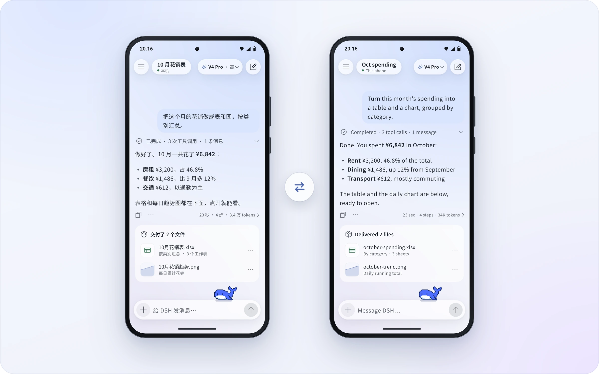
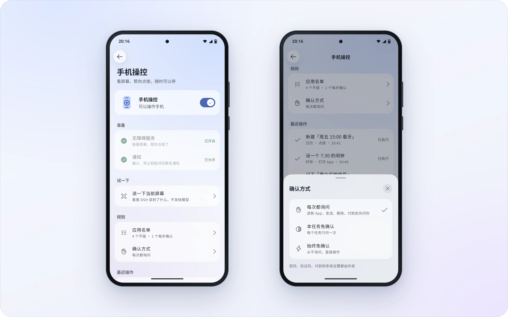

<p align="center">
  <b>简体中文</b> · <a href="README.en.md">English</a>
</p>

# DSH Go 社区版

这是基于 [ccch1mneyyy 的 DSH Go](https://github.com/ccch1mneyyy/dsh-go) 独立维护的社区 Fork。可以在 Android 手机上运行 DeepSeek Harness，也可以连接电脑或服务器上的引擎。

## 社区版的改进

- **普通聊天里连续执行。** 1.0.19 可以在手机本地处理等待、按文字查找、条件分支和有限循环。需要 AI 判断时，进度和可用截图交回原会话。
- **无障碍树缺少目标时用截图定位。** 依据当前截图和应用授权进行点按、手势和输入。页面变化后重新定位。
- **同一条消息可以只确认一次。** 确认应用、联系人和完整正文后，同一手机任务的搜索、输入和发送可以共用授权。
- **保存常用任务并一键启动。** 自动任务页可保存带参数的任务，便于反复执行。

[下载 ARM64 安装包](https://github.com/puppy-bai/dsh-Go/releases/latest) · [手机操控指南](docs/guide/zh/04-phone-control.md) · [更新日志](docs/changelog.md) · [提交反馈](https://github.com/puppy-bai/dsh-Go/issues)

社区版安装包在本仓库 Releases 下载。同签名安装包可覆盖更新并保留数据。若签名不匹配，请保留现有安装，以免丢失聊天、设置和插件。1.0.16～1.0.18 需手动下载安装包才能切换到社区版更新源。新版本由 [Android Release 工作流](.github/workflows/release.yml) 在 CI 通过后处理。

<h3 align="center">本机运行，也能遥控电脑</h3>

<p align="center">内置 Linux 环境，免 Root、免 Termux。电脑上的 DSH，也能一键切过去接着用。</p>

<p align="center">
  <picture>
    <source media="(prefers-color-scheme: dark)" srcset="docs/assets/f-remote-zh-dark.webp">
    
  </picture>
</p>

<br>

<h3 align="center">插话、打断，过程自动收好</h3>

<p align="center">回复中途也能插话，排队的消息随时「立即发送」。做完的过程折叠成一行。</p>

<p align="center">
  <picture>
    <source media="(prefers-color-scheme: dark)" srcset="docs/assets/f-steer-zh-dark.webp">
    
  </picture>
</p>

<br>

<h3 align="center">原生界面，也有网页版</h3>

<p align="center">和官方网页版一键切换，停在同一段对话，下次打开还是你上次用的那个。</p>

<p align="center">
  <picture>
    <source media="(prefers-color-scheme: dark)" srcset="docs/assets/f-web-zh-dark.webp">
    
  </picture>
</p>

<br>

<h3 align="center">分享卡、对话回放和链接</h3>

<p align="center">回复一键做成分享卡。整段对话生成链接，对方在浏览器里回放，链接端到端加密。</p>

<p align="center">
  <picture>
    <source media="(prefers-color-scheme: dark)" srcset="docs/assets/f-share-zh-dark.webp">
    
  </picture>
</p>

<br>

<h3 align="center">横屏与平板</h3>

<p align="center">横屏手机和平板重新排版：侧栏常驻，内容居中，弹出键盘也不挤。</p>

<p align="center">
  <picture>
    <source media="(prefers-color-scheme: dark)" srcset="docs/assets/f-adaptive-zh-dark.webp">
    
  </picture>
</p>

<br>

<h3 align="center">主题配色与桌面图标</h3>

<p align="center">六套主题色，也能跟随壁纸或自选颜色。四款桌面图标，三种功能图标风格。</p>

<p align="center">
  <picture>
    <source media="(prefers-color-scheme: dark)" srcset="docs/assets/f-theme-zh-dark.webp">
    
  </picture>
</p>

<br>

<h3 align="center">中文，也说 English</h3>

<p align="center">全部界面支持英文，在设置里切换，默认跟随系统。</p>

<p align="center">
  <picture>
    <source media="(prefers-color-scheme: dark)" srcset="docs/assets/f-lang-dark.webp">
    
  </picture>
</p>

<br>

<h3 align="center">手机操控</h3>

<p align="center">看屏幕、帮你点，三档确认随你选。敏感操作默认交还给你；放宽应用规则或解除限制前，请先了解风险。</p>

<p align="center">
  <picture>
    <source media="(prefers-color-scheme: dark)" srcset="docs/assets/f-phone-zh-dark.webp">
    
  </picture>
</p>

<br>

## 可以做什么

DSH Go 提供聊天界面、本机运行环境和远程连接，是基于 [DeepSeek Harness](https://github.com/deepseek-ai/deepseek-harness) 的第三方项目。运行在手机上的是 DSH 引擎；模型请求仍由你配置的模型提供方处理。

- **本机运行**：在 App 内安装 Ubuntu、Node.js 与 DSH 运行环境，无需 Root 或另装 Termux。
- **远程连接**：通过 SSH 或李国宝老师开发的 [DSHarness Remote](https://github.com/liguobao/ds-harness-remote) 使用电脑、服务器上的 DSH。
- **聊天与工具**：切换模型，发送图片、使用语音输入，处理工具审批和提问；支持聊天界面与网页模式。
- **插件界面**：使用适配 DSH Go 的原生工具卡、表单和面板；仓库提供 SDK、教程和示例。
- **手机操控**：在你开启权限后，让本机引擎读取屏幕、点按和输入，并可随时停止。
- **分享与外观**：分享、导出和回放对话，调整主题、图标和桌宠。

功能随主机和连接方式不同。DSHarness Remote 当前只支持图片附件，不能在 App 内打开网页版，插件管理限于开关，且不支持 DS Bot 和对话日志导出。详见[本机引擎与远程主机](docs/guide/zh/03-engine-hosts.md)。

## 安装

安装要求为 Android 8.0（API 26）及以上。Release 页面上的 **arm64** 安装包适用于常见的 64 位 Android 手机；x86_64 设备和模拟器用的 x64 包在发布说明末尾的「其他版本下载」里。仓库没有 32 位 ARM 构建。

1. 从[社区版 Releases](https://github.com/puppy-bai/dsh-Go/releases/latest)下载 `arm64` 安装包，并按 Android 提示安装。
2. 首次启动时，选择在本机安装运行环境，或连接远程主机。
3. 为所选主机配置模型和所需凭据，再开始对话；部分远程渠道需要在主机侧配置。

仅连接远程主机时，不必在手机上安装本机运行环境。手机操控只对正常模式下的本机引擎开放，需要按界面说明开启无障碍等权限；不打扰模式另外要求 Android 14 及以上，以及 Shizuku 或自连 ADB。首次使用可按[使用指南](docs/guide/README.md)逐项配置。

本地引擎默认使用 PRoot 兼容启动。开发者选项中的直接启动默认关闭，开启后的兼容性和回退方式见[常见问题](docs/guide/zh/11-faq.md)。当前 Android 构建以 APK 侧载为目标，不是 Google Play 发布配置。

<a id="gesture"></a>
## 坐标手势（本 Fork 新增）

上游的坐标能力只有「按坐标点一下」（`tap_xy`）；长按只能按元素来，而且时长被写死成
`ViewConfiguration.getLongPressTimeout() + 300` 毫秒；滑动只能落在列表滚动上。这个 Fork 增加了
第 14 个工具 `gesture`：参数是一条 **steps** 序列，所有坐标都是最近一次 `screen` 标号截图的像素（图上的 W×H）。
（第 15 个工具 `input` —— 按坐标写入 —— 见[下一节](#input)。）

| kind | 作用 | 必要参数 | 可选参数 |
| --- | --- | --- | --- |
| `tap` | 点击 | `x` `y` | `duration` 毫秒（默认 60） |
| `long` | **长按任意时长** | `x` `y` | `duration` 毫秒（默认 800，可写 9000） |
| `double` | 双击 | `x` `y` | `gap` 两次点击间隔 40–300ms（默认 120）、`duration` ≤300ms |
| `swipe` | 直线滑动 | `x` `y` `x2` `y2` | `duration` 毫秒（默认 300） |
| `path` | 沿任意路径滑 | `points`：`[[x,y],…]`（2–32 点） | `duration` 毫秒 |
| `pinch` | 双指缩放 | `x` `y` `spread` 像素（正数放大、负数缩小） | `duration` 毫秒 |

一次最多 10 步、10 个触点、总时长 60 秒（系统 `GestureDescription` 的上限）。顶层 `gap` 指定两步之间停多久（默认 120ms），
`double` 那两次点击的间隔由该步自己的 `gap` 决定。

典型用法：把列表项按住 3 秒，再上滑，然后双击。

```json
{
  "observation": "s7",
  "steps": [
    {"kind": "long",   "x": 540, "y": 1200, "duration": 3000},
    {"kind": "swipe",  "x": 540, "y": 1500, "x2": 540, "y": 700, "duration": 500},
    {"kind": "double", "x": 540, "y": 1200}
  ]
}
```

想画弧线绕开中间的按钮就用 `path`：`{"kind":"path","points":[[200,1800],[500,1500],[800,1200]],"duration":600}`。
捏合缩放用 `pinch`：中心 `x` `y`、`spread` 是**每根手指移动量的两倍**（每根手指移动 `spread÷2`），正数放大、负数缩小。

**安全边界没有放松**：坐标手势和 `tap_xy` 一样每次都要你确认；自己 App 的界面、系统权限页、读不到内容的页面照样拒绝；
后台屏（Shizuku / 自 ADB 那条路）仍然只按元素编号，不接受坐标。实现细节与取舍见 [docs/gesture-zh.md](docs/gesture-zh.md)。

<a id="input"></a>
## 坐标输入与按文字操作（本 Fork 新增）

上游写文字只有 `type`：先用 `screen` 看清输入框的编号，再 `tap` 那一行，再 `type` —— 同一件事三次调用，而且
坐标点开的输入框到下一屏编号就变了。这个 Fork 加了第 15 个工具 `input`，把「点坐标 → 找焦点 → 写入 → 回读 →
收键盘」压成一次调用；另外给 `tap` 加了按文字点、给 `screen` 和 `scroll` 加了 `until`。

### `input`：按坐标写入

| 参数 | 必填 | 说明 |
| --- | --- | --- |
| `observation` | 是 | 最近一次 `screen` 的屏幕号（必须带 `image`，坐标是那张标号截图的像素） |
| `x` `y` | 是 | 输入框在截图上的像素坐标 |
| `text` | 是 | 要写进去的文字（最多 2000 字） |
| `submit` | 否 | 写完后按一次输入法回车 |

它在设备端连续试四件事，中间不返回，所以一次调用就有结果：

1. 在坐标上点一下，等界面稳定；
2. 在所有窗口里找当前焦点（`findFocus(FOCUS_INPUT)`）。焦点是输入框就用 `ACTION_SET_TEXT` 写入，然后每 100ms
   回读一次、共 1.5 秒，确认文字真的进去了（比较时忽略空白、连字符和零宽字符）；
3. 焦点没落到输入框，就改成长按 600ms 再找一次 —— 不少页面只有真按住才聚焦；
4. 还不行就走剪贴板：先把文字放进剪贴板，对焦点发 `ACTION_PASTE`；节点不支持粘贴就再长按，然后在弹出的菜单里
   按文字点「粘贴」。

写完时如果键盘是升起的，才发一次返回键收起来（键盘会盖住下一张截图的坐标）。密码框一律拒绝：焦点框是不是密码框
只有聚焦之后才知道，所以确认卡片只显示坐标和字数，不显示要写的文字，操作日志也只记长度。

```json
{"observation": "s7", "x": 540, "y": 760, "text": "13800138000"}
```

坐标的守卫和 `tap_xy` 完全一样：屏幕号过期、点不在截图里、自己 App 的界面、系统权限页、读不到内容的页面、
以及「无法确认界面仍与截图一致」都会拒绝；后台屏仍然只按元素编号，不接受坐标。

### 另外三个参数

- `tap` 加 `text`：按界面上看得见的文字点，不用先查编号。`id` 和 `text` 二选一；一段文字匹配到多个元素会**拒绝并列**，
  把候选（`#7「删除」`）列出来让你用 `id` 指定 —— 猜错一次就是点错东西，所以不猜。
- `screen` 加 `until`：等这段文字出现再返回（最多 5 秒），省掉模型自己反复读屏；`detail:true` 现在给的是元素边界
  （`左上-右下`），不再是中心点，坐标落在哪个元素上更好判断。
- `scroll` 加 `until` / `max`：一直往这个方向滚到出现这段文字为止（默认最多 10 次），用来看列表深处的内容。

真机自测顺序建议：`screen` 带 `image` → `input` 写一个正常输入框 → `input` 带 `submit` → `tap` 带 `text` 点「登录」
→ `scroll` 带 `until` 找列表深处的条目。

## 数据与权限

模型请求会发送给你配置的提供方。开启手机操控后，任务需要的屏幕文字可能发送给模型，支持看图的模型也可能收到截图；请先阅读 App 的权限说明。

“发送匿名使用统计”默认开启，可在首次引导或“设置 → 隐私与分享”关闭。采集范围和关闭后的处理见[常见问题](docs/guide/zh/11-faq.md)。分享内容前，请检查预览；收到链接或文件的人可以保存其中的内容。

## 风险提示与免责声明

DSH Go 是社区开发的非官方项目，与 DeepSeek 无关联，也不代表 DeepSeek。使用前请了解：

- **AI 并非万无一失**：回答、代码和操作可能出错，也可能被网页、消息或文件中的恶意指令误导。请核验重要结果；医疗、法律、投资等高风险决策不应仅依赖 AI 输出。
- **工具会产生真实影响**：本机或远程主机上的命令、文件修改及手机操控可能导致数据丢失、隐私泄露、账号、资金或设备损失。免确认、放宽应用规则或解除限制会减少保护；确认与拦截机制不能保证消除所有风险。建议保留默认保护，只授予必要权限，不在存有支付或银行信息的设备上解除限制。详见[手机操控指南](docs/guide/zh/04-phone-control.md)。
- **第三方服务与费用**：模型、远程主机和插件等按各自条款运行；相关数据处理、服务可用性和费用取决于你选择的服务与配置。本机运行不等于模型离线，也不代表数据不会离开设备。
- **使用前做好防护**：备份重要数据，只连接可信主机、安装可信插件，留意模型用量与费用；不要让 AI 无人值守地处理不可逆或高风险任务。
- **无担保与责任范围**：在适用法律允许的范围内，本软件按“现状”提供，不保证准确性、持续可用性或满足特定用途；相关无担保及责任限制见 [LICENSE](LICENSE) 第 15–17 条。本声明不排除或限制依法不得排除或限制的责任，也不减损你依法享有的权利。

## 常见问题

<details>
<summary><b>和 DeepSeek 官方是什么关系？</b></summary>
<br>

没有关系。DSH Go 是社区开发的非官方客户端，基于开源的 [DeepSeek Harness](https://github.com/deepseek-ai/deepseek-harness) 构建。手机上运行的是 DSH 本身；模型请求发给你配置的模型提供方，需要联网，按你在提供方的账户计费。

</details>

<details>
<summary><b>安全吗？</b></summary>
<br>

本机网页版只接受 App 自己的访问。分享链接端到端加密，密钥只在链接里，服务器看不到内容，但获得完整链接的人可以读取并保存内容。手机操控默认保留敏感操作保护；放宽应用规则或开启「解除限制」会减少这些保护。安全机制不能保证零风险，详见[风险提示与免责声明](#风险提示与免责声明)和[手机操控指南](docs/guide/zh/04-phone-control.md)。

</details>

<details>
<summary><b>切到后台会被杀吗？</b></summary>
<br>

部分系统的省电策略会拦住后台。DSH Go 发现后会提醒你，并直达对应的放行设置，vivo、小米、华为、荣耀、OPPO 都有。

</details>

<details>
<summary><b>对手机有什么要求？</b></summary>
<br>

Android 8 及以上。手机直接下载 Release 页面上的安装包即可，模拟器用的 x86_64 版在发布说明末尾的「其他版本下载」里。在手机上运行 DSH 要先准备内置的运行环境，请预留约 1 GB 空间；只连电脑或服务器上的 DSH 可以不装。

</details>

<details>
<summary><b>开源吗？</b></summary>
<br>

开源，代码就在这个仓库，以 [AGPL-3.0](LICENSE) 发布，`sdk/` 和 `examples/` 为 MIT。DSH Go 的名称和标识，以及 Deepy、鲸娘两位吉祥物，不在开源授权范围内，见 [ASSETS.md](ASSETS.md)。再发布和 fork 时的署名要求见[授权范围与再发布](#授权范围与再发布)。

</details>

## 从源码构建

以下流程面向 **Linux x86_64**。当前工具链脚本默认安装 JDK 17、Flutter 3.47.7 和 Android SDK/NDK；App 要求 Dart `^3.13.5`。准备 Bash、Git、curl、tar、unzip、xz、Python 3、zstd（Python 未提供 `compression.zstd` 时用于解包 zstd 压缩的 deb）、file 和常见 GNU 命令；重新解析 Ubuntu 软件包锁时还需要 gpgv。

先取得完整源码和项目资源。`app/pubspec.yaml` 声明的字体、图片等都是构建输入，运行时包由下面的脚本生成。

```bash
git clone <本仓库地址> dsh-go
cd dsh-go

bash tooling/setup-toolchain.sh
source tooling/env.sh
flutter --version
java -version

bash runtime/build-runtime.sh arm64-v8a
DSH_BETA_TOKEN_FILE= bash tooling/build-apk.sh -f arm64 --keep-daemon
```

工具链脚本会下载 SDK/NDK 与模拟器镜像，并执行 Android SDK 许可接受步骤。默认安装到 `~/dev`；可通过 `DEV_ROOT` 指定独立目录。脚本会复用已有安装，构建前请核对版本。

产物为 `app/build/app/outputs/flutter-apk/app-arm64-release.apk`。运行时构建使用仓库固定的版本与校验信息，并需要联网下载依赖。示例中的 `DSH_BETA_TOKEN_FILE=` 不嵌入维护者的内测通道令牌；`--keep-daemon` 保留 Gradle daemon，适合同时开发其他 Android 项目的环境。

构建 x86_64 包时，先生成对应运行时：

```bash
bash runtime/build-runtime.sh x86_64
DSH_BETA_TOKEN_FILE= bash tooling/build-apk.sh -f x64 --keep-daemon
```

未配置 `app/android/key.properties` 时，本地 release 构建使用 debug 签名。它不能直接覆盖不同签名的官方安装包；请在测试设备上安装，保留已有数据，不要为解决签名冲突直接卸载正在使用的 App。发布签名与密钥文件不要提交到仓库。

只查看 APK 构建命令，可运行：

```bash
DSH_BETA_TOKEN_FILE= bash tooling/build-apk.sh --dry-run -f all
```

## 目录

| 路径 | 内容 |
| --- | --- |
| `app/` | Flutter 界面与 Android Kotlin 平台实现 |
| `packages/dsh_client/` | DSH Web API 的 Dart 客户端 |
| `packages/dsh_remote/` | DSH Remote 的 Dart 客户端 |
| `runtime/` | Linux 运行时打包、引擎补丁与 App 桥接 |
| `sdk/plugin-kit/` | 原生插件作者工具包；在仓库中使用，未发布到 npm |
| `examples/plugins/` | 插件示例 |
| `docs/guide/`、`docs/plugins/` | 用户指南与插件开发文档 |
| `docs/assets/` | 本页用到的展示图、桌宠动图和社群二维码 |
| `tooling/` | 工具链、APK 构建与诊断脚本 |
| `services/`、`site/`、`infra/` | 配套分享服务、网站和部署材料 |

## 参与贡献

请在[社区版 Issues](https://github.com/puppy-bai/dsh-Go/issues)提交问题和建议。代码和文档约定见 [CONTRIBUTING.md](CONTRIBUTING.md)。插件开发可参考[教程](docs/plugins/README.md)和 [SDK](sdk/plugin-kit/README.md)。

安全问题请按 [SECURITY.md](SECURITY.md) 报告。

## 授权范围与再发布

代码以 [AGPL-3.0](LICENSE) 开源，欢迎 fork 学习、自用和二次开发。请尊重原作者和项目来源：

- 请保留页首所列的原作者 ccch1mneyyy 和上游仓库来源，并按适用许可证保留版权、许可和修改声明。
- **禁止未授权商业化套皮**：不得未经授权将本项目的品牌标识、Deepy、鲸娘等受保护素材用于套皮售卖、收费分发或其他商业产品；不得违反适用许可证，删除应保留的版权与许可声明、闭源分发衍生代码，或冒充原作者、官方版本。
- **名称与素材另有限制**：DSH Go 的名称、标识，以及 Deepy、鲸娘形象不在 AGPL 授权范围内，以修改版身份发布时请换成自己的名称和素材，见 [ASSETS.md](ASSETS.md)。

**许可说明**：AGPL-3.0 允许符合其条款的修改、再发布和商业使用。品牌与素材须遵守各自的授权条件；本说明不改变 `sdk/`、`examples/` 及第三方内容的许可。

## 许可证与致谢

本项目采用 [AGPL-3.0](LICENSE)；`sdk/` 和 `examples/` 保持 **MIT**。第三方代码和素材以各自声明为准。

- [DeepSeek Harness](https://github.com/deepseek-ai/deepseek-harness)：DSH Go 运行和连接的就是它。
- DSH-TUI 是 Deepy 与鲸娘素材的来源。

Phase 相关代码经作者许可使用。DeepSeek Harness、PiPilot、DS Bot、DSH Remote 及其他第三方组件、素材保留各自的许可证和署名。具体来源和条款见 [THIRD_PARTY_NOTICES.md](THIRD_PARTY_NOTICES.md)。

DSH Go 的名称、标识、Deepy 小鲸鱼和鲸娘等形象不在 AGPL 授权范围内，使用条款见 [ASSETS.md](ASSETS.md)。

<sub>远程连接参考了 [ds-harness-remote](https://github.com/liguobao/ds-harness-remote) 的项目和服务器，感谢作者李国宝。</sub>

<br>

<p align="center"><sub>DSH Go 是社区开发的非官方客户端，与 DeepSeek 没有关联，也不代表 DeepSeek。DeepSeek 名称与标识归其所有者所有。</sub></p>
